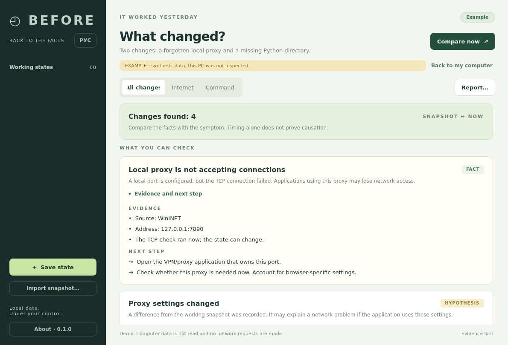

<p align="center"></p>
<h1 align="center">BEFORE</h1>
<p align="center"><strong>It worked yesterday. See what changed.</strong></p>
<p align="center">A local desktop app for comparing working computer settings with the present.<br>Read-only diagnostics · Evidence you can inspect · No account or cloud</p>

[Русский / запуск](README.ru.md) · [How diagnosis works](docs/design.md) · [Scenario suite](benchmarks/README.md)



## The workflow

1. **Remember a working state.** BEFORE saves a small snapshot of important settings.
2. **Compare when something breaks.** Select that state and check the current computer.
3. **Inspect the evidence.** See exact changes, confirmed observations and possible explanations.
4. **Share a reviewed report.** Edit the redacted text before saving Markdown or a standalone HTML file.

The app inspects proxy settings, PATH, command file resolution, hosts entries
and a small set of network services. It never executes the command you type.

A changed setting is not automatically blamed. For example, a proxy change is
a hypothesis; a failed TCP connection to its configured local port is a separate
observation. The app shows both and explains what remains unknown.

## Run

### Portable desktop build

Unpack the portable folder and launch **BEFORE** on Linux or **BEFORE.exe** on
Windows. Keep `_internal` beside the executable. Python is bundled in portable
builds. This repository's GitHub Actions workflow builds both OS versions and
uploads them as workflow artifacts; it does not publish releases automatically.

The initial delivery includes a Linux x86-64 portable build. A Windows portable
binary must be built on Windows (locally or by the included workflow).

### From source

Use Python **3.10–3.13**, then open `start.cmd` on Windows or run:

```bash
chmod +x start.sh
./start.sh
```

First launch creates `.venv` and downloads the pinned Qt dependency from PyPI.
Later launches work offline. Alternatively:

```bash
python -m venv .venv
# Activate .venv using your shell's normal command.
python -m pip install -r requirements.txt
python run.py
```

`python run.py --demo` opens a clearly marked, entirely synthetic example. Demo
data is never mixed into your history or presented as a scan of your computer.

The interface and exported reports default to English. Use the **РУС**
button for an immediate in-app switch, or launch with `python run.py --lang ru`.

## What is covered

| Area | Windows | Linux |
|---|---|---|
| Proxy | Current user's manual WinINET settings, PAC URL presence, process proxy environment | Process proxy environment |
| PATH | Fresh machine + user registry values; expanded using BEFORE's environment | BEFORE's inherited process PATH |
| Commands | File lookup in absolute PATH directories, `.exe/.com/.bat/.cmd` | Executable file lookup in absolute PATH directories |
| hosts | Normalized host/address entries | Normalized host/address entries |
| Services | Dhcp, Dnscache, BITS via native APIs | NetworkManager, systemd-resolved via bounded `systemctl show`, if present |

Default command snapshots check `python`, `python3`, `git`, `node`, `npm` and
`ffmpeg`. Select **Команда** and enter another basename to include it in the next
snapshot or diagnosis. A custom command absent from an old snapshot is never
treated as a known-good baseline.

BEFORE does not diagnose arbitrary crashes, drivers, hardware failures, BSODs,
all Linux desktop proxy settings, WinHTTP, browser-specific settings or every
service. It does not execute PAC files. It does not change or repair OS settings.
There is no background recorder: snapshots are taken explicitly.

## Network behavior

- Saving or comparing snapshots initiates **no HTTP/TCP connectivity probes**.
- Live diagnosis may open a short TCP connection to an explicitly configured
  **numeric loopback / localhost proxy port**. It does not scan remote proxy ports.
- External checks are opt-in under **Интернет**. They issue HTTPS HEAD requests
  to the hostname you select (default `example.com`), directly and through a
  supported explicit HTTP/HTTPS proxy. The direct check deliberately bypasses
  the explicit proxy. System DNS resolution is also attempted.
- No response body is read; redirects are not followed. TLS verification stays
  enabled. No cookies, credentials, snapshots or reports are uploaded.
- The external worker is killed after 12 seconds. An incomplete check is
  reported as unknown, rather than failure of the site or ISP.

Known remote PATH directories (Windows UNC/network drives and common Linux
network mounts) are skipped. Collectors still perform filesystem metadata
reads: a symlink, unusual mount or redirected profile can cause the operating
system itself to access a network filesystem. No HTTP/TCP connectivity probe
is initiated while saving a snapshot.

## Privacy and local data

History lives in `%LOCALAPPDATA%\Before` (Windows) or
`${XDG_DATA_HOME:-~/.local/share}/before` (Linux). `BEFORE_DATA_DIR` overrides it.
SQLite writes are transactional; snapshot imports are validated and capped at
2 MB. Raw snapshots include paths, proxy hosts and hosts-file entries. Proxy URL
userinfo and query tokens are removed before saving. Raw snapshots are intended
for your own use.

The report preview hides usernames in common home-directory paths. It retains
useful suffixes, hostnames and server addresses; review or edit those before
sharing. HTML export escapes all content and contains no scripts or remote
assets. Export never sends the file anywhere.

## CLI

The engine and CLI use only the Python standard library; Qt is needed for the GUI.

```bash
python run.py cli snapshot working.json --label "Everything works"
python run.py cli diagnose --baseline working.json --output report.html
python run.py cli diagnose --symptom command --command ffmpeg
python run.py cli diagnose --symptom internet --probe example.com
python run.py cli compare working.json later.json --output report.md
python run.py cli history
```

The same commands work after a portable executable: `BEFORE cli ...`.
`compare` is always offline; live probes require `diagnose`.

## Develop, verify, build

```bash
python -m pip install -e ".[dev]"
ruff check src tests scripts benchmarks run.py
ruff format --check src tests scripts benchmarks run.py
pytest -q
python benchmarks/run.py
python scripts/build.py
```

Build output: `dist/BEFORE/`. Build on the target OS; PyInstaller does not cross
compile a Windows application from Linux. The Windows build uses a hidden
console bootloader so the isolated network worker retains functioning pipes.

Tests include false-positive cases, strict snapshot import, real loopback
sockets, local storage, CLI export, Qt layout and the save → compare → edit →
export desktop workflow. The scenario suite is synthetic and is not a claim of
measured real-world diagnostic accuracy. See [validation](docs/validation.md)
for what was actually executed for the initial delivery.

## Design rule

Every finding must show an observation, its limits and a useful next step.
An empty diff does not promise that the computer is healthy. Unreadable data
does not become a deleted setting. Differences between computers do not become
proof of a regression.

MIT for BEFORE source. Qt/PySide and bundled runtime components keep their own
licenses; see [THIRD_PARTY.md](THIRD_PARTY.md).
